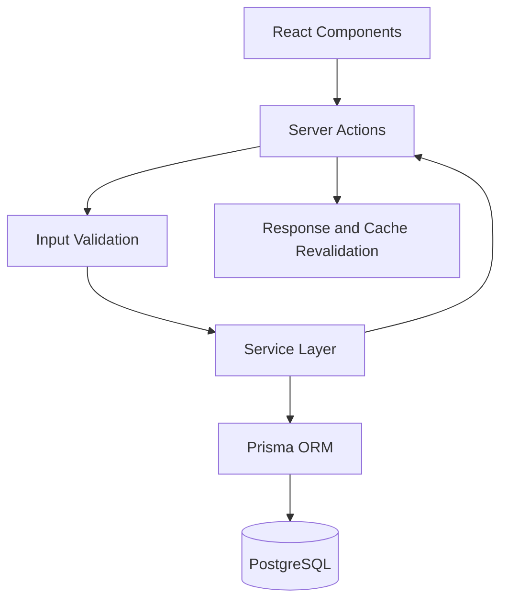

# Corintek Project Information System (CPIS)

CPIS is a web application developed for Corintek to help manage field operations across water treatment and facility management projects.

Before the system was introduced, many operational activities relied on paper forms, spreadsheets, and separate reporting processes. CPIS brings these activities together in one place, allowing teams to manage projects, record daily operations, monitor equipment, submit work reports, and prepare monthly reports.

The application serves different types of users, including administrators, field technicians, and clients. Each user has access to the information and operations relevant to their responsibilities.

> **Project status:** This was a completed client engagement. The original client environment is no longer actively used or maintained. The repository is retained as an engineering portfolio project and reflects the application implementation and subsequent technical improvements.

## What the Application Does

### Project and User Management

The application provides tools to manage clients, projects, users, and project personnel. Equipment, operational parameters, and other configurations can be managed within their respective projects.

### Daily Operational Log Sheets

Field technicians can record daily operating conditions and measurements for equipment such as chillers and cooling towers. The forms support multiple machines, different measurement categories, chemical consumption records, and photo attachments.

Measurements can be checked against configured parameter limits. The application also supports draft records, submission, approval, digital signatures, and printable reports.

### Work Reports

Technicians can submit reports about maintenance activities and other work performed at a project location. Reports can include descriptions, photographs, and signatures, and follow an approval workflow.

### Attendance and Absence

Attendance records include clock in and clock out activities, supported by photo capture. Administrators can review attendance records, while absence information is managed through a separate workflow.

### Laboratory Analysis

Laboratory analysis forms allow users to record measurement results in a structured format. The information can be reviewed and presented through printable report layouts.

### Monthly Summary Reports

The application brings together project information into monthly summary reports. Users can include supporting documents such as PDFs, configure report sections, and prepare reports for printing and sign off.

### Dashboard and Notifications

The dashboard provides an overview of project activities and operational information through metrics, charts, and recent activity.

Notifications help users identify operational parameter limit breaches and other relevant events.

### Client Portal

The client portal is designed as a read only area for clients. Each client can view information and reports belonging to their respective projects, without being able to create or modify operational records.

## Technology

The application uses the following technologies:

| Area                  | Technology                              |
| --------------------- | --------------------------------------- |
| Application framework | Next.js 16                              |
| User interface        | React 19                                |
| Programming language  | TypeScript 5.9                          |
| Styling               | Tailwind CSS 4                          |
| UI components         | Radix UI and shadcn based components    |
| Database              | PostgreSQL                              |
| Database access       | Prisma 7                                |
| Authentication        | JWT, jose, bcrypt and HTTP only cookies |
| Input validation      | Zod                                     |
| File storage          | Cloudflare R2                           |
| Storage gateway       | Cloudflare Workers                      |
| Automated testing     | Vitest and Playwright                   |
| Code quality          | ESLint and Prettier                     |

## Application Architecture

CPIS uses the Next.js App Router. Most internal application operations are handled through Server Actions rather than a separate REST API.

The application follows a feature oriented structure. Each business area has its own components and application logic, while shared utilities and infrastructure are maintained separately.

A typical request moves through the following flow:



The interface handles user interactions and presents the data. Server Actions act as the entry point for operations initiated by the interface. Input is validated before being passed to the service layer, where business rules and data operations are handled.

Prisma provides typed access to the PostgreSQL database.

### Authentication and Permissions

Authentication uses JWT sessions, with password hashing handled through bcrypt.

Access is controlled through role based permissions. In addition to checking a user's role, the application applies project specific authorization so that access to operational information is limited to the projects a user is permitted to access.

This is particularly important for the client portal, where each client should only see information belonging to their assigned projects.

### File Storage

Application files, photographs, and supporting documents are stored in Cloudflare R2. A dedicated Cloudflare Worker handles communication between the application and the storage buckets.

The storage implementation includes separate authorization for write operations and short lived HMAC signed URLs for reading files.

Development and production have separate Worker configurations and bucket bindings. The development Worker has been deployed and tested with both signed and unsigned file requests. The updated production Worker configuration has not yet been deployed, so the repository does not claim that production has received the same security update.

## Repository Structure

```text
.
├── prisma/
│   └── schema/             # Database schema definitions
├── src/
│   ├── app/                # Next.js pages and layouts
│   ├── components/         # Shared interface components
│   ├── features/           # Business features and application logic
│   ├── hooks/              # Shared React hooks
│   ├── lib/                # Application utilities and infrastructure
│   ├── @types/             # Domain specific TypeScript types
│   └── types/              # Shared TypeScript types
├── worker/
│   ├── src/                # Cloudflare Worker implementation
│   └── wrangler.*.jsonc    # Worker environment configurations
├── scripts/                # Maintenance and automation scripts
├── docs/                   # Technical documentation
└── package.json
```

## Getting Started

### Requirements

You will need:

- Node.js and npm
- A PostgreSQL database
- A Cloudflare account with R2 access if you want to use the file storage features

A local PostgreSQL installation is not necessary. You can use a managed PostgreSQL database from a provider such as Neon or Supabase for development. The application itself runs locally and connects to that database.

### Installation

Clone the repository and install its dependencies:

```bash
git clone <repository-url>
cd <repository-directory>
npm install
```

### Environment Configuration

Configure the application environment in `.env.development`.

At minimum, the database connection and authentication configuration must be provided. For file storage, refer to `.env.r2.example`, which documents the additional R2 configuration.

The main R2 environment variables are:

| Variable               | Purpose                                                         |
| ---------------------- | --------------------------------------------------------------- |
| `R2_WORKER_URL`        | Worker endpoint used by the application                         |
| `R2_LEGACY_WORKER_URL` | Optional previous Worker endpoint for existing stored file URLs |
| `R2_AUTH_SECRET`       | Secret used to authorize file write operations                  |
| `R2_SIGNING_SECRET`    | Secret used to generate signed file read URLs                   |

The application and the corresponding Worker must use matching secrets. Do not commit environment files or expose credentials in source code.

### Database Setup

Generate the Prisma client:

```bash
npm run prisma:generate
```

Apply the existing database migrations to your development database:

```bash
npm run prisma:migrate
```

The Prisma scripts in this project use `.env.development` for database configuration.

### Run the Application

Start the Next.js development server:

```bash
npm run dev
```

The application will be available at `http://localhost:3000`.

### Run the Cloudflare Worker

The storage Worker can also be started locally:

```bash
cd worker
npm run dev
```

This is needed when developing or testing functionality that communicates with Cloudflare R2.

## Testing

The project uses Vitest for automated unit and integration tests, with Playwright available for browser based end to end testing.

Run the test suite:

```bash
npm run test:run
```

Start the test runner in watch mode:

```bash
npm run test:watch
```

Generate test coverage:

```bash
npm run test:coverage
```

Run end to end tests:

```bash
npm run test:e2e
```

The end to end tests use a separate `.env.e2e.local` environment configuration.

ESLint can be run with:

```bash
npm run lint
```

## Engineering Experience

Working on CPIS involved more than implementing forms and connecting them to a database. Several parts of the application required careful consideration of how operational data should be recorded, reviewed, approved, and accessed by different users.

Some of the more interesting engineering challenges included maintaining data integrity across approval workflows, organizing access permissions around both user roles and projects, handling operational measurements against configurable limits, and integrating file storage without exposing unrestricted access to stored objects.

The codebase also went through several rounds of restructuring and improvement. As the application grew, attention shifted toward making its business logic easier to follow, improving the separation of responsibilities, strengthening authorization, and making the system easier to maintain.

These improvements are reflected in the current source code and its accompanying tests.

## Project Notes

This repository represents the application developed during a client engagement. It contains the application source code and technical implementation, but does not include client credentials, private operational data, or access to the original infrastructure.

The original hosted environment is no longer guaranteed to be available. Running the application independently requires a separately configured PostgreSQL database, the necessary environment variables, and Cloudflare credentials for functionality that depends on file storage.
